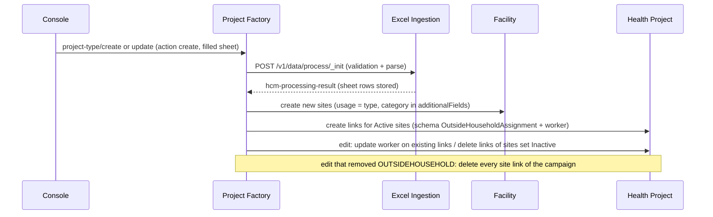
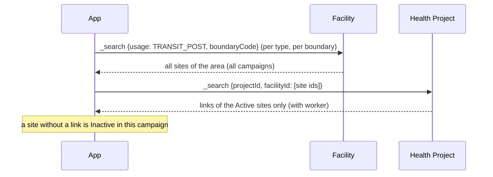

# Outside Household Sites Design (HCMPRE-2371)

## Overview
Outside Household (OH) is a campaign delivery method: children are vaccinated outside their homes, at
**Outside Household Places** (schools, markets, health posts, ...) and **Transit Posts** (bus stations, checkpoints, ...).
These places are called **sites**. This document explains how project-factory, excel-ingestion, facility and
health-project work together to plan sites in the unified template, create them with the campaign, and serve them to
the app.

---

## Service Architecture

### Core Components
- **excel-ingestion**: adds the Outside Household sheet to the unified template (`OutsideHouseholdSheetGenerator`), checks
  the uploaded rows (`OutsideHouseholdValidationProcessor`) and decides when the sheet applies
  (`OutsideHouseholdTypeMasterService`).
- **project-factory**: turns site rows into facilities and project-facility links at campaign create / edit
  (`processCampaignFacilitiesFromExcelData`), and rebuilds the template when OH is added or removed in a draft
  (`isGenerationTriggerNeeded`).
- **facility**: stores a site as a facility; its search leaves sites out of broad searches (`FacilityRepository`).
- **health-project**: stores the site's use in a campaign as a project-facility link; its search leaves site links out of
  broad searches (`ProjectFacilityRepository`).
- **MDMS** `HCM.OUTSIDE_HOUSEHOLD_TYPES`: the site types, read by excel-ingestion, facility and health-project
  (`OutsideHouseholdTypeService`, cached 5 minutes).

### Key Features
- **No new service, table or API**: a site is a facility, its use in a campaign is a project-facility link.
- **Site type = facility `usage`** (`OUTSIDE_HOUSEHOLD_PLACES`, `TRANSIT_POST`); the category is in the facility's
  `additionalFields`.
- **Active / Inactive is per campaign** and exists only as link / no link.
- **Frontline worker on the link only**, so it never reaches the next campaign.
- **Carry-over**: Permanent sites of earlier campaigns are offered again, as Inactive.
- **Existing consumers unchanged**: broad facility and project-facility searches never return sites.

---

## API Endpoints Summary

| Endpoint | Service | Use for sites |
|---|---|---|
| `POST /excel-ingestion/v1/data/generate/_init` | excel-ingestion | Unified template with the Outside Household sheet |
| `POST /excel-ingestion/v1/data/process/_init` | excel-ingestion | Validate / parse the uploaded sheet |
| `POST /project-factory/v1/project-type/create`, `/update` | project-factory | Campaign drafts, create, edit; template rebuild on OH change |
| `POST /facility/v1/_create`, `/bulk/_create`, `/_update` | facility | Create / update a site (project-factory, or the app) |
| `POST /facility/v1/_search` | facility | Sites of an area (`usage` + `boundaryCode`), or by `id` / `clientReferenceId` |
| `POST /health-project/facility/v1/_create`, `/bulk/_create`, `/_update` | health-project | Link a site to a campaign; update its worker |
| `POST /health-project/facility/v1/_search` | health-project | Site links of a campaign (`projectId` + `facilityId`) |
| `POST /egov-mdms-service/v2/_search` (`HCM.OUTSIDE_HOUSEHOLD_TYPES`) | MDMS | Site types, default Site Status, categories per type |

---

## API Flow Diagrams

### 1. Template Generation
```mermaid
sequenceDiagram
    participant Console
    participant PF as Project Factory
    participant EI as Excel Ingestion
    participant MDMS
    participant FAC as Facility

    Console->>PF: project-type/update (draft, cycleData.deliveryMethods + OUTSIDEHOUSEHOLD)
    Note over PF: isGenerationTriggerNeeded: OH added/removed
    PF->>PF: wait until the stored campaign has the boundaries and the OH choice
    PF->>EI: POST /v1/data/generate/_init (unified-console, additionalDetails: this update's deliveryMethods + projectType)
    Note over EI: uses the request's deliveryMethods / projectType; reads the stored campaign only for missing values
    EI->>MDMS: HCM.OUTSIDE_HOUSEHOLD_TYPES
    Note over EI: POLIO + OUTSIDEHOUSEHOLD + active type => add the OH sheet
    EI->>PF: campaign's stored site rows
    EI->>FAC: _search usage=<type>, isPermanent=true (carry-over)
    EI-->>Console: template with Outside Household sheet
```

### 2. Campaign Create / Edit


### 3. App: Active Sites of a Campaign


---

## API Flow Descriptions

### 1. When the Outside Household Sheet Appears
```
Campaign saved (draft)
    ↓
projectType in excel.ingestion.outside.household.campaign.types (default POLIO)?
    ↓ yes
additionalDetails.cycleData.deliveryMethods contains OUTSIDEHOUSEHOLD?   (strings or {code}, upper-cased, separators ignored)
    ↓ yes
HCM.OUTSIDE_HOUSEHOLD_TYPES has an active row?
    ↓ yes
4th sheet HCM_ADMIN_CONSOLE_OUTSIDE_HOUSEHOLD_LIST is added
```
- The console must keep `cycleData.deliveryMethods` on **every** create/update; a save that drops it makes the campaign look
  like it has no OH. The `deliveryMethod` on the delivery rules is not read for the sheet.
- On a draft update (new campaign or campaign edit) that adds or removes `OUTSIDEHOUSEHOLD`, project-factory generates a new
  template and sends **this update's** `deliveryMethods` and `projectType` in the generate request (`additionalDetails`).
  excel-ingestion decides the sheet from those values, so the template matches the update even when the stored campaign is
  not saved yet; it reads the stored campaign only for values the request does not carry (for example a template requested
  directly later). project-factory also still waits until the stored campaign has the update (4 tries,
  `BOUNDARY_SYNC_RETRY_DELAY_MS` apart). An update without a `deliveryMethods` list does not trigger a new template.

### 2. Sheet Columns
| Column (key `HCM_ADMIN_CONSOLE_OUTSIDE_HOUSEHOLD_*`) | Rule |
|---|---|
| Boundary columns + Service Boundary Code | Lowest or second-lowest boundary level of the campaign |
| `CLIENT_REFERENCE_ID` (hidden) | Pre-filled for existing sites; blank for new rows |
| `TYPE` | Required: Outside Household Places / Transit Posts |
| `CATEGORY` | Required; one of the categories of that type (`categories` in the MDMS row) |
| `NAME` | Required, 2-200 characters |
| `STATUS` | Required: Permanent / Temporary; new rows default from `isPermanentByDefault` |
| `USAGE` | Required: Active / Inactive |
| `WORKER_NAME`, `WORKER_PHONE` | Optional; saved on the link of an Active site |

Pre-filled rows: the campaign's own stored sites, then every Permanent site of the campaign's lowest two boundary levels
from earlier campaigns (Inactive, no worker). Their name, type, category, status and boundary are locked.

### 3. Campaign Create
```
Site row (Active or Inactive)
    ↓
clientReferenceId = pre-filled id | stored row with same type+boundary+name | new UUID
    ↓
Facility created/kept: usage = type, isPermanent = status, locality = boundary,
                       additionalFields.fields = [{outsideHouseholdCategory: <code>}]
    ↓
Active?  → project-facility link: additionalFields {schema: OutsideHouseholdAssignment, version: 1,
                                                    fields: frontlineWorkerName / frontlineWorkerPhone}
Inactive? → no link
```
Links carry the user who created or edited the campaign in `auditDetails`.

### 4. Campaign Edit
| Change in the edit | Result |
|---|---|
| New row | New site; linked if Active |
| Active -> Inactive | Link deleted (`isDeleted: true`); the site stays |
| Worker changed on an Active site | Existing link's `additionalFields` updated (`health-project/facility/v1/_update`) |
| `OUTSIDEHOUSEHOLD` removed from the delivery methods | Every site link of the campaign deleted; facility links and site records stay |
| `OUTSIDEHOUSEHOLD` added back | Sheet shows each site as before; uploading links the Active ones again |

The unlink on OH removal runs only when all guards hold: an edit (`parentId`), a present, non-empty and readable
`deliveryMethods` list without `OUTSIDEHOUSEHOLD`, no delivery rule still naming it, and stored sites
(`isOutsideHouseholdDeliveryDropped`). Switch: `OUTSIDE_HOUSEHOLD_UNLINK_ON_DELIVERY_REMOVAL`.

### 5. Searching Sites
The facility and project-facility **tables** hold every site and site link. Only the **default answers** of two searches
leave them out, so existing consumers (the app's normal facility download, stock / warehouse / referral pickers) keep
seeing only normal facilities:

| API | Left out when the request has... | Returned when the request has... |
|---|---|---|
| `POST /facility/v1/_search` | none of `usage`, `id`, `clientReferenceId` | `usage` (a site type), `id` or `clientReferenceId` |
| `POST /health-project/facility/v1/_search` | neither `facilityId` nor `id` (also `boundaryTypes` searches) | `facilityId` or `id` |

`TotalCount` counts only returned records. `boundaryCode` is an exact match. With `includeDeleted=true` a link removed in
an edit comes back with `isDeleted: true`. If MDMS cannot be read the last site-type list is used; with no list nothing
is hidden.

---

## Key Design Patterns

### 1. **Sites as Facilities**
A site reuses the facility and project-facility records and APIs; `usage` tells it apart. No new table, topic or migration.

### 2. **Active / Inactive as Link**
Every sheet row is saved as a site; only Active rows get a link. The facility record has no Active/Inactive field.

### 3. **Worker on the Link**
The frontline worker is per campaign, so it lives on the link and is never copied to the next campaign.

### 4. **Hide by Default, Return on Request**
Broad searches leave sites out; a request that names a site type, a site id or a site's `facilityId` gets them.

### 5. **Guarded Changes**
Destructive steps (unlink on OH removal) run only when the campaign data is complete; the template rebuild uses the
update's own delivery methods, so it does not depend on the stored copy being saved in time.

---

## Configuration

| Service | Key (default) | Purpose |
|---|---|---|
| excel-ingestion | `excel.ingestion.outside.household.campaign.types` (`POLIO`) | Campaign types that can get the OH sheet |
| facility | `egov.mdms.host` (`http://mdms-v2.egov:8080/`, env `EGOV_MDMS_HOST`), `egov.mdms.v2.search.path` (`egov-mdms-service/v2/_search`) | Reading site types to hide sites |
| health-project | `egov.mdms.v2.search.path` (`egov-mdms-service/v2/_search`); host = existing `EGOV_MDMS_HOST` | Reading site types to hide site links |
| project-factory | `OUTSIDE_HOUSEHOLD_UNLINK_ON_DELIVERY_REMOVAL` (`true`) | Edit that removes OH unlinks the sites |
| project-factory | `EGOV_PROJECT_FACILITY_UPDATE_PATH` (`health-project/facility/v1/_update`) | Updating a link's worker in an edit |
| project-factory | `BOUNDARY_SYNC_RETRY_DELAY_MS` (`4000`, existing) | Wait between checks before a template rebuild |

No new Kafka topics, database migrations or persister changes.

### MDMS, Localisation and Indexer
- **MDMS (state tenant):** schema + data `HCM.OUTSIDE_HOUSEHOLD_TYPES` (`code`, `active`, `isPermanentByDefault`,
  `categories`); sheet schema `outside-household-microplan-ingestion` in `HCM-ADMIN-CONSOLE.schemas`; the OH sheet entry in
  the `unified-console` row of `HCM-ADMIN-CONSOLE.excelIngestionGenerate` and in the `unified-console-validation` /
  `unified-console-parse` rows of `HCM-ADMIN-CONSOLE.excelIngestionProcess` (add these only after the new excel-ingestion
  is running); for the console, `deliveryMethods` on the POLIO record of `HCM-PROJECT-TYPES.projectTypes`.
- **Localisation:** module `hcm-admin-schemas`, 28 messages per locale (sheet name, headers, types, categories, statuses, errors).
- **Indexer** (`configs`, `health/egov-indexer`): sites go to `outside-household-index-v1`, site links to
  `outside-household-campaign-index-v1`; the facility and project-facility indexes no longer receive them. The site type
  codes in the indexer yml must match the MDMS master. Restart egov-indexer after a change.

---

## Error Handling

### Upload Errors (`OutsideHouseholdValidationProcessor`)
| Code | When |
|---|---|
| `HCM_OUTSIDE_HOUSEHOLD_BOUNDARY_REQUIRED` | No boundary selected |
| `HCM_OUTSIDE_HOUSEHOLD_BOUNDARY_INVALID_LEVEL` | Boundary not on the lowest or second-lowest level |
| `HCM_OUTSIDE_HOUSEHOLD_CATEGORY_NOT_FOR_TYPE` | Category does not belong to the site type |
| `HCM_OUTSIDE_HOUSEHOLD_DUPLICATE_SITE` | A **new** row repeats another site (same type, boundary and name); pre-filled rows are not checked |
| `IMMUTABLE_CELL_TAMPERED` | A locked column of a pre-filled row was changed |

### Known Limits
- The site search has no campaign input and no Active/Inactive field; callers find Active sites through the links.
- Site facilities carry no `additionalFields.schema` / `version`; clients that require `version` must default it.
- A new row marked Temporary + Inactive creates a site that is never used and never offered again.
- Removing OH in an edit deletes the site links, not the site records.
